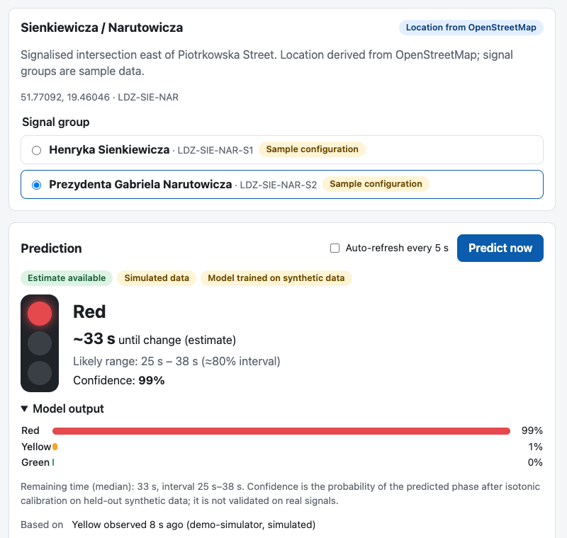
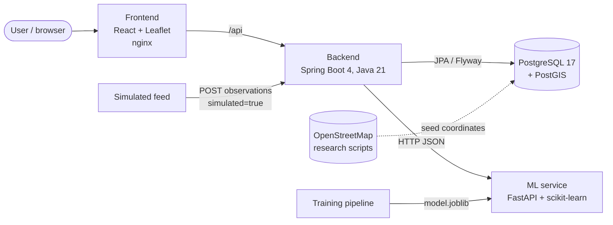

# Traffic Light Predictor

**Building AI course project**

> [!WARNING]
> Research prototype – **not** a driver assistance or traffic control system. Predictions are
> statistical **estimates, not guarantees**. The current demo runs on **simulated observations**
> and a model trained on **synthetic data**, and it is **not connected to any traffic signal
> controller**. Always obey the actual signal and traffic rules.

[](.github/workflows/ci.yml)

## Summary

Traffic Light Predictor is an AI-based project that aims to predict traffic signal phases and estimate the time until the next phase change in Łódź, Poland. It explores how historical observations and machine learning could help drivers better anticipate traffic lights.

The repository contains a working, locally runnable research prototype: a web application, a REST API with a PostGIS database, and a machine learning pipeline that estimates the current phase, the remaining time and a calibrated confidence. It also states explicitly when a reliable prediction is not possible. Real traffic signal observations have not been collected yet, so the prototype currently runs on clearly labelled simulated data.

## Background

Drivers approaching traffic-light-controlled intersections often do not know how long the current signal phase will last. For example, when approaching a green light, they cannot easily determine whether it will remain green for several seconds or change shortly.

Traffic Light Predictor aims to address this problem by estimating the current traffic signal phase and predicting the approximate time until the next phase change.

The initial project scope focuses on Łódź, Poland.

The motivation behind this project is to explore how artificial intelligence and data analysis can be applied to everyday urban mobility challenges. Better predictions could help drivers make more informed decisions while approaching intersections.

## How is it used?

The planned solution is intended primarily for drivers approaching traffic-light-controlled intersections.

The proposed workflow is:

1. The mobile application determines the driver's location using GPS.
2. The system identifies the upcoming intersection and relevant traffic signal.
3. Available historical observations and contextual information are retrieved.
4. A prediction model estimates the current signal phase and the time until the next phase change.
5. The application presents the estimated phase, remaining time and prediction confidence.

For example, the application could display:

- Current phase: GREEN
- Estimated time until change: approximately 12 seconds
- Prediction confidence: 87%

These values are illustrative examples, not results from a deployed model.

If the system cannot make a sufficiently reliable prediction, it should clearly communicate that the prediction is unavailable.

The application is intended as a driver assistance tool. It must never encourage speeding, dangerous braking or ignoring traffic regulations. Predictions should always be treated as estimates, not guarantees.

### Current prototype

The prototype is a web application rather than a mobile app. The user selects an intersection on a map of Łódź (or the API finds nearby ones) and chooses a signal group. The app then shows:

- the estimated phase;
- the remaining time with a likely range;
- the confidence;
- whether the input data was real or simulated.

If the latest observation is too old, or the model is not confident enough, the app shows "No reliable estimate" instead of a number.



## Data sources and AI methods

The project depends on collecting and analysing traffic signal observations and contextual data.

Potential data sources include:

- **[OpenStreetMap](https://www.openstreetmap.org/):** road infrastructure, intersection locations, road geometry and potentially mapped traffic signals.
- **[Open Data Łódź – Transport and Communication](https://otwarte.miasto.lodz.pl/transport_komunikacja/):** public transport datasets, including static GTFS data (routes, stops and timetables) and GTFS-Realtime data (vehicle positions, trip updates and service alerts). These datasets could provide additional context about public transport activity near selected intersections.
- **Own observations:** collected traffic signal phases, timestamps, GPS positions, intersection identifiers and travel directions.
- **Additional contextual data:** time of day, day of the week, weather and traffic volume, where available.

It is important to note that the available Open Data Łódź transport datasets do not directly provide historical traffic signal phases or signal timing information. Collecting reliable traffic light observations will therefore be a key part of the project.

Current status of the data sources:

| Source | Status |
|---|---|
| OpenStreetMap | **Used.** Locations and OSM signal node ids of the demo intersections (ODbL) |
| Open Data Łódź GTFS / GTFS-RT | **Investigated, not integrated.** It describes vehicles, not signals |
| Own observations | **Not collected yet.** The ingestion API is ready |
| Synthetic simulator | **Used** for training and the demo; every record is labelled `simulated` |

Potential AI and data analysis methods include:

- Statistical baseline models based on historical signal phase durations.
- Supervised machine learning for predicting the next traffic signal phase.
- Regression models for estimating the remaining duration of a signal phase.
- Computer vision as a potential future method for detecting traffic light colours from camera images.

The prototype implements the first three:

- a statistical cycle baseline;
- a gradient-boosted classifier (scikit-learn) with isotonic probability calibration for the phase;
- gradient-boosted quantile regression with conformal intervals for the remaining time.

Data is split chronologically to avoid leakage. A reliability policy withholds predictions that are not confident enough.

The models are evaluated using Mean Absolute Error (MAE), Root Mean Squared Error (RMSE), phase classification accuracy, precision, recall, F1-score and probability calibration. So far they have been evaluated **only on synthetic data** (see [Evaluation](#evaluation-and-results)). Conclusions about real traffic signals require retraining and evaluation on a reliable dataset of real observations.

## Challenges

The project has several important limitations and challenges:

- **Data availability:** reliable traffic signal phase and timing datasets may not be publicly available.
- **Data quality:** observations may be incomplete, inconsistent or inaccurate.
- **Changing traffic conditions:** signal timing may depend on traffic volume, pedestrian crossings, public transport and other factors.
- **Prediction uncertainty:** the system cannot guarantee that a predicted phase change will happen at the estimated time. In simulation, accuracy drops quickly as the last observation gets older.
- **Safety:** incorrect predictions must not encourage unsafe driving decisions.
- **Scalability:** different intersections and cities may use different traffic signal configurations.

The system must be able to communicate uncertainty and avoid presenting unreliable predictions as facts.

## What next?

The project will follow an experiment-driven development approach.

The planned development stages are:

1. ✅ Investigate available traffic and infrastructure data sources.
2. ✅ Identify and map selected traffic-light-controlled intersections in Łódź.
3. Collect and analyse traffic signal observations.
4. Build an initial dataset.
5. ✅ Implement a statistical baseline model.
6. ✅ Experiment with machine learning models (synthetic data so far).
7. ✅ Evaluate prediction quality using appropriate metrics (synthetic data so far).
8. ✅ Develop a backend API and geospatial data service.
9. Build an Android application.
10. Test the solution in real-world conditions.

In the future, the project could be expanded to other cities, incorporate crowdsourced observations, use computer vision and integrate with Android Auto.

## Acknowledgments

- [Elements of AI – Building AI](https://buildingai.elementsofai.com/) – educational material and inspiration for this project.
- [OpenStreetMap](https://www.openstreetmap.org/) – geographical and road infrastructure data, © OpenStreetMap contributors, available under the [ODbL](https://www.openstreetmap.org/copyright).
- [Open Data Łódź – Transport and Communication](https://otwarte.miasto.lodz.pl/transport_komunikacja/) – public transport datasets for Łódź, including GTFS and GTFS-Realtime data.
- Open-source software: [scikit-learn](https://scikit-learn.org/), [Spring Boot](https://spring.io/projects/spring-boot), [PostGIS](https://postgis.net/), [FastAPI](https://fastapi.tiangolo.com/), [React](https://react.dev/), [Leaflet](https://leafletjs.com/).
- Romano, Patterson & Candès (2019), *Conformalized Quantile Regression* – method used for the remaining-time intervals.

This project is an independent educational initiative. External datasets, software and other materials will be credited according to their respective licences and terms of use.

---

# Technical documentation

## Project Status

Research & Development: working prototype on simulated data.

| Capability | Status |
|---|---|
| Intersections in Łódź with signal groups and nearby search (PostGIS) | ✅ 6 intersections. Locations from OpenStreetMap; signal groups are **sample** data |
| Observation storage and ingestion API (validation, DB constraints, API key) | ✅ |
| ML pipeline: validation, EDA, features, chronological split, training, evaluation, persistence | ✅ |
| Phase prediction with calibrated confidence and a remaining-time interval | ✅ |
| Statuses `OK`, `LOW_CONFIDENCE`, `INSUFFICIENT_DATA`, `UNSUPPORTED_SIGNAL`, `MODEL_UNAVAILABLE` | ✅ |
| Web UI: map, phase visualisation, confidence, real/simulated badges, observation history | ✅ |
| Real observations of Łódź signals | ❌ Not collected yet |

## Architecture



| Directory | Contents |
|---|---|
| `backend/` | Spring Boot REST API, Flyway migrations, JUnit/Testcontainers tests |
| `ml/` | Python package `tlp_ml`: simulator, training pipeline, FastAPI service, simulated feed |
| `frontend/` | React + TypeScript single-page app served by nginx |
| `research/osm/` | OpenStreetMap feasibility scripts |
| `docs/` | Architecture, ML pipeline, data sources, API and development guides |

## Technology stack

| Area | Technologies |
|---|---|
| Backend | Java 21, Spring Boot 4.1 (Web MVC, Data JPA/Hibernate, Validation, Actuator), Flyway, springdoc-openapi |
| Database | PostgreSQL 17 + PostGIS 3.5 |
| ML | Python 3.12+, pandas, NumPy, scikit-learn, joblib, FastAPI |
| Frontend | React 19, TypeScript, Vite, Leaflet, Vitest + Testing Library |
| Tests | JUnit 5, Mockito, MockMvc, Testcontainers, pytest |
| Infrastructure | Docker, Docker Compose, GitHub Actions |

## Quick start

Requirements: Docker with Compose v2.

```bash
git clone https://github.com/Senegalion/TrafficLightPredictor.git
cd TrafficLightPredictor
cp .env.example .env
docker compose up --build     # or: make up
```

| URL | What |
|---|---|
| http://localhost:3000 | Web UI |
| http://localhost:8080/swagger-ui.html | API documentation |
| http://localhost:8000/docs | ML service (internal) |

The first build trains the model inside the ML image (about 40 s). The `simulator` service then
posts about 2 hours of **simulated** history and continues in real time, with gaps between
observation sessions. A prediction can therefore be `OK`, `LOW_CONFIDENCE` or `INSUFFICIENT_DATA`.
That is intended behaviour.

To run the tests: `make test` (backend tests need Docker). Local development without Docker is
described in [docs/development.md](docs/development.md).

## API

Base path `/api/v1`. The full reference is in [docs/api.md](docs/api.md).

| Method | Path | Description |
|---|---|---|
| GET | `/intersections` | Intersections with signal groups |
| GET | `/intersections/{id}` | One intersection |
| GET | `/intersections/nearby?latitude=&longitude=&radiusMeters=` | Nearest intersections |
| GET | `/intersections/{id}/observations` | Observations, newest first |
| POST | `/intersections/{id}/observations` | Submit an observation (`X-Api-Key`) |
| POST | `/predictions` | Request a prediction |
| GET | `/predictions/{id}` | A stored prediction |
| GET | `/model` | Model version and training-data origin |

## Evaluation and results

> [!IMPORTANT]
> Measured on **synthetic demonstration data**: 28 days, 6 intersections, 12 signal groups,
> 475,654 observations, chronological test split. These numbers show that the pipeline works.
> They are **not** evidence about real Łódź traffic signals.

| | Gradient boosting | Statistical baseline |
|---|---|---|
| Phase accuracy | **0.570** | 0.469 |
| Macro F1 | **0.570** | 0.427 |
| Remaining-time MAE | **7.9 s** | 12.9 s |
| Remaining-time RMSE | **11.8 s** | 17.9 s |

- Accuracy drops from 0.83 (observation < 1 min old) to 0.47 (7–15 min old).
- Only 4.8% of test queries pass the reliability gate. For those, phase accuracy is 96.1% and MAE
  is 3.5 s.
- The 80% interval achieved 79.9% coverage.

Full reports: [ml/reports/metrics.md](ml/reports/metrics.md) and [ml/reports/eda.md](ml/reports/eda.md).

## Limitations

- No real observations yet. Signal groups and timing plans are invented sample data.
- RED+YELLOW is treated as RED. Flashing and pedestrian signals are not modelled.
- Confidence is calibrated on synthetic data only and is not a safety guarantee.
- The system is not connected to any traffic signal controller.

## Documentation

- [Project Analysis](docs/project-analysis.md): research hypothesis, risks, evaluation criteria and development plan
- [Architecture](docs/architecture.md)
- [ML pipeline](docs/ml-pipeline.md)
- [Data sources](docs/data-sources.md)
- [API](docs/api.md)
- [Development guide](docs/development.md)

## License

MIT. See [LICENSE](LICENSE). OpenStreetMap-derived data is © OpenStreetMap contributors (ODbL).
