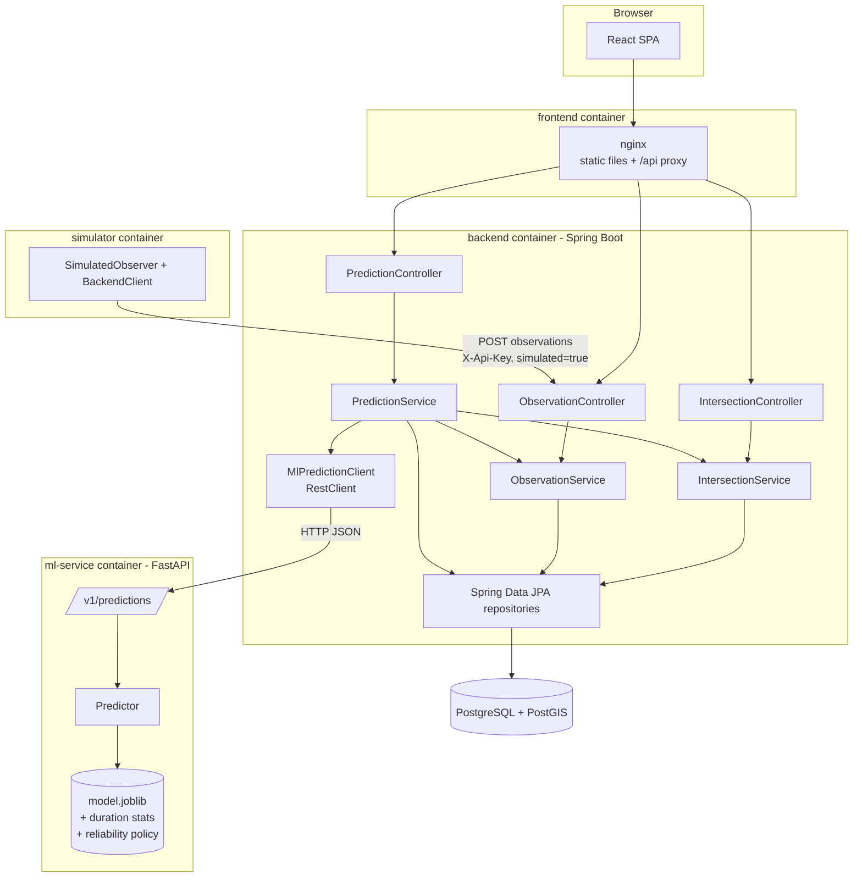
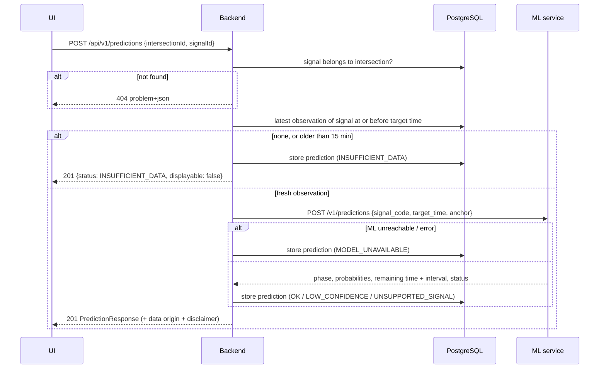
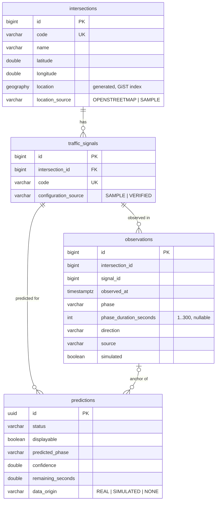

# Architecture

## Overview

The MVP is a small modular system: one Java backend, one Python ML service, one static frontend and
PostgreSQL/PostGIS. There is no message broker and no microservice mesh. The only reason for a
second backend process is that the models are scikit-learn objects, which the JVM cannot load.

## Prediction flow

## Backend module structure

Packages are organised **by feature**, not by layer:

| Package | Contents |
|---|---|
| `intersection` | `Intersection`, `TrafficSignal` entities, repositories (incl. native PostGIS `findNearby`), service, controller, DTOs |
| `observation` | `Observation` entity, repository (anchor lookup, paging), service (validation rules), controller, DTOs |
| `prediction` | `PredictionRecord` entity, service (data-sufficiency rules and orchestration), controllers, DTOs |
| `prediction.ml` | `MlPredictionClient` port, HTTP adapter, request/response contracts, configuration |
| `common` | Problem-detail exception handler, API-key interceptor, CORS, OpenAPI config, shared enums |

## Database

Managed by Flyway (`backend/src/main/resources/db/migration`). Hibernate only validates the schema.

Integrity is enforced in the database, not only in Java:

- a composite foreign key `(signal_id, intersection_id)` guarantees that an observation or
  prediction refers to a signal of *that* intersection;
- `UNIQUE (signal_id, observed_at)` prevents duplicate observations;
- `CHECK` constraints restrict phases, directions, statuses, probabilities and durations;
- `location` is a stored generated `geography(Point, 4326)` column, so it always matches lat/lon.

## Key design decisions

| Decision | Rationale |
|---|---|
| Separate Python ML service instead of exporting the model to the JVM | Keeps one ML codebase (training and serving share feature code, avoiding training/serving skew). ONNX/PMML export of the full pipeline (calibration, conformal margin, history statistics) would add complexity. |
| Backend owns data-sufficiency rules; ML service repeats them | The backend avoids a network call when there is no usable observation. The ML service stays safe to call directly. |
| Store every prediction | Traceability, and the basis for evaluating predictions against real observations later. |
| `simulated` is a required input field | Every record must be explicitly labelled real or simulated; there is no default. |
| Observation = "phase started at time t" (+ optional duration) | Matches what a human or camera can record, and lets labels be derived from real data in the same way as from synthetic data. |
| Shared API key for ingestion, no Spring Security | There are no user accounts. A full security setup would add complexity without benefit at this stage. |
| No ML health dependency for backend readiness | The backend degrades gracefully (`MODEL_UNAVAILABLE`) instead of going down with the ML service. |
| Multi-arch PostGIS image (`imresamu/postgis`) by default | The official `postgis/postgis` image is amd64-only. The image is configurable via `POSTGIS_IMAGE`. |

## Observability

- Health: `GET /actuator/health` (readiness and liveness probes enabled) for the backend,
  `GET /health` for the ML service (reports `DEGRADED` if no model is loaded). Docker health checks
  use both.
- Logs: the backend logs ECS JSON in Docker (`LOGGING_STRUCTURED_FORMAT_CONSOLE=ecs`). The Python
  services log JSON lines (`TLP_LOG_FORMAT=json`, or `text` for local use).
